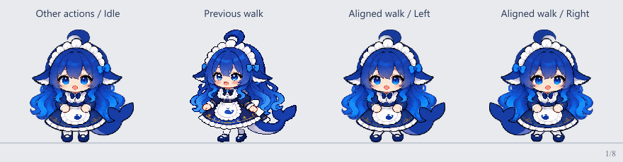

# 默认 Deep seek 行走与原动作比例对齐

这里修正「默认 · Deep seek」入口中的蓝眼睛、蓝白女仆装角色，与鲸鱼娘高清／像素双形态分开。新行走使用其他六个内置角色的小步方式，并直接保留原待机的头脸、头发、手、围裙、裙摆和鲸鱼尾巴。



## 像素来源与分层

身体取自 `assets/animations/idle.png` 首格，原图集为 1774 × 887 像素，格距 443.5；读取首格 444 × 443 像素，仅向 512 × 512 工作画布平移，不缩放人物。左右完整腿鞋从同一原图分离，腿根连接裙摆，脚踝以下整只原鞋只平移。每帧一脚落地，身体起伏为原尺寸 ±1 像素；右行使用相同图集镜像。八帧各 125 毫秒，总周期一秒。

运行时 `actionSheets` 令行走与待机共用 397.5 源像素的比例基准，透明留白和图集尺寸不会再放大人物。前景衣裙遮住移动腿根，鞋形、颜色和短腿比例保持原图。

- `render.mjs`：从实际待机图重新拆层并生成八帧、独立腿层、图集和 `rig.json`；默认不写入生产素材。
- `rig.json`：来源坐标、掩膜、腿根／脚踝、步态、落脚基线和帧记录。
- `body.png`、`frames/`、`legs/near/`、`legs/far/`：原身体前景、审定八帧和两条完整腿鞋层。
- `sources/walk-before.png`：修改前的行走图集，供比例对照。
- `preview.ts`：生成待机、旧行走、新左行、新右行的八张对照帧。
- `idle-walk-comparison.gif`：便于审阅的对照动画；GIF使用10毫秒计时单位，125毫秒帧需要交替取整，插件仍按精确125毫秒播放。

## 复现与验证

在项目根目录安装依赖后运行：

```powershell
node design/deepseek-walk-aligned-v1/render.mjs
npx tsx design/deepseek-walk-aligned-v1/preview.ts
npx tsx --test tests/walking-assets.test.ts tests/whale-walking.test.ts
```

生成图集为本目录的 `walk-left.png`；正式运行使用 `assets/animations/walk.png`。检查后再将审定图集复制到正式位置。测试直接检查正式素材，验证全身体像素与待机一致、完整鞋RGBA只平移、双脚连通、交替支撑、镜像、固定基线，以及80像素显示下八帧各不相同的腿部轮廓。

本改动复用原人物像素与现有连续腿脚变形方法，没有再次生成角色原画。其他内置角色见[角色与行走说明](../character-walks.md)，鲸鱼娘另一入口见[双形态说明](../whale-dual-forms.md)。
