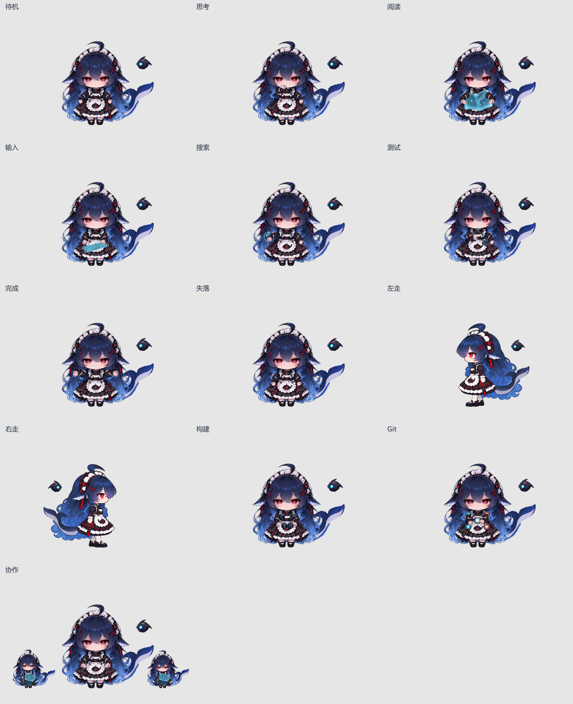
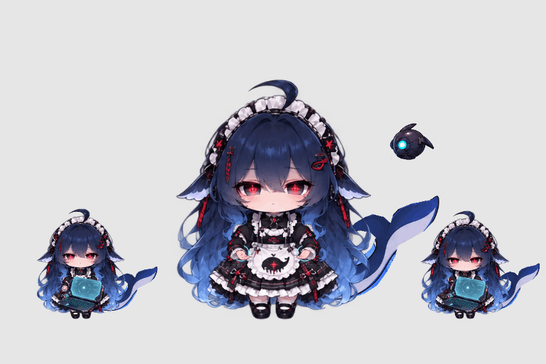

# 鲸鱼娘像素／高清双形态 · 0.1.26

在「本地资源」选择「鲸鱼娘 · 像素」或「鲸鱼娘 · 高清」，再使用动画条上的形态按钮切换。扫描光从上向下显现新形态，历时 650 毫秒，保留任务阶段、播放时钟与当前场景；系统开启“减少动态效果”时直接切换。未保存角色选择时默认使用像素形态。

原生「默认 · Deep seek」是另一入口：蓝眼睛、蓝白女仆装，使用 `assets/animations/` 中的素材与稳定选择 ID `default-deepseek`。它的小步行走从原待机像素拆层，见[比例对齐记录](deepseek-walk-aligned-v1/README.md)。

## 动作与节奏

高清形态提供 13 套动作，每套 8 帧，每帧 125 毫秒。成功与失败播放一秒后回到待机，其他动作循环。

| 动作 | 高清表现 |
| --- | --- |
| `idle` | 原正面待机，补齐相连鲸尾与悬浮机器人 |
| `think` | 手靠近下巴思考 |
| `read` | 正面托住悬浮书页 |
| `type` | 操作悬浮键盘与面板 |
| `search` | 指向搜索全息界面 |
| `check` | 用探针扫描悬浮芯片 |
| `build` | 双手操控模块，组装悬浮立方体 |
| `git` | 操作分支节点与汇合光路 |
| `agents` | 主角居中，两个约 45% 大小的实体分身在两侧操作终端 |
| `success`／`failed` | 任务完成／遇到问题的一秒反应 |
| `walk-left`／`walk-right` | 已确认的侧面小步行走，右行镜像 |

分身在协作循环中持续存在，进入和退出协作时各播放一次 450 毫秒扫描，不在每秒循环里反复召唤。独立工作阶段保持原地，避免闲逛打断操作姿势。

像素形态保留原有 10 套动作与各自时长，本次没有按高清版配套重绘。缺少独立 `build`／`git` 时使用同一角色的 `check`，缺少 `agents` 时使用 `search`。因此两个形态共享任务阶段与切换操作，但工作姿势不完全相同。

## 人物一致性与来源

高清正面动作以用户确认的正面待机为共同人物来源：脸、发饰、长发、躯干、围裙、裙摆、短腿、袜鞋使用同一套原始图层；只在手臂遮挡区域补底，并叠加统一手臂与科幻道具。每个人物保持两条完整手臂。尾巴和机器人沿用已确认行走的部件，正面动作统一尾巴连接、大小、机器人站位与漂浮规则。分身从同一人物图层缩放，不另画一套角色。

补底、手臂部件与道具使用内置 `image_gen` 工具结合用户参考生成，再通过原生图层动画合成。左右走路保留此前确认的姿势、尺寸和透明度，只统一蓝色色调。完整高清原生图层工程不在本次发布源码中重建；发布保留审定的无损图集、manifest 和可导入 ZIP，不能将解包误作重新生成原画的流程。

## 交付文件与校验

- `assets/characters/whale-dual-hd/manifest.json`：高清 13 套动作、统一锚点与 `rendering: "smooth"`；引用七张 `consistent-v2-*.webp` 无损图集。
- `assets/characters/whale-dual-pixel/manifest.json`：像素形态的原有动作与最近邻渲染。
- `examples/character-packs/whale-dual-hd.toons.zip` 与 `whale-dual-pixel.toons.zip`：可直接导入的完整包，随插件安装。

内置包经 Harness Host 的精确允许列表读取。预览与正式插件共用 manifest 和资源包校验规则；测试检查动作帧数、时长、独立工作动作、镜像与透明边界、形态切换及兼容回退。默认 Deep seek 另检查头脸／服装与待机像素一致、原鞋只平移、交替落脚及 80 像素显示下的八帧轮廓差异。

运行 `npm test` 和 `npm run preview` 检查；高清协作可用 `http://127.0.0.1:3088/?form=hd&action=agents`。资源格式见[本地资源包说明](../docs/local-resource-packs.md)，当前内置角色结构见[角色与行走说明](character-walks.md)。
