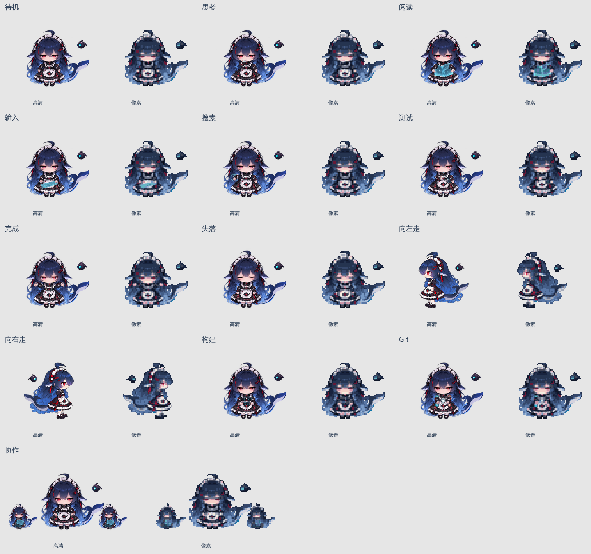

# 鲸鱼娘双形态源工程与人物验收

两种形态现在共用 13 套动作、每套 8 帧 × 125 毫秒。构建、Git、协作都使用独立姿势；两个实体分身约为主角的 45%，在协作循环内持续工作。高清正面、侧面行走仍是已确认素材，像素版从对应的高清帧统一导出，人物中心、尾巴、机器人、道具和左右脚阶段保持对应。



## 可编辑文件

- `front/layers/`：原正面待机 8 帧、手臂遮挡区补底、8 种左右手臂、鲸尾、机器人以及各工作道具。`front/render.cjs` 保留肩膀轴、手势、层次、次级摆动与分身位置；只在原手臂遮挡区补底。
- `walk/layers/`：身体与裙摆、下半长发、尾巴、机器人、近远侧完整手臂、腿与鞋；`rig.json` 和 `extraction.json` 保存 8 个步态、关节轴与落脚线。`walk/render.cjs` 导出每帧的 8 层透明 PNG，可分别编辑。
- `front/prompts.json`、`front/props-prompt.txt`：历史原画提示词。此次配套像素动作复用现有分层工程，没有重新生成角色原画。
- `identity.json`：固定的人物区域、时长、分身比例与人工看图清单。
- `source-lock.json`：44 个源图层和关键工程文件的校验值。
- `approved-hd-frames.json`：已确认高清 104 帧的完整解码 RGBA 基准。普通构建不重写基准。
- `pixel-export.json`：固定 1:8 网格、27 色共用调色板、二值透明度及两形态帧的对应校验值。

本目录只在源码仓库保存，不进入插件安装包。

## 每次换素材后的验收

在项目根目录运行：

```powershell
npm ci
npm run characters:check
npm run characters:review
```

对比页默认位于 `http://127.0.0.1:3096/`，可以切动作、播放、暂停和拖动 8 个关键帧。检查结果、双形态总览、5 套工作动作的像素八帧展开图和独立帧图片位于 `work/character-review/`。即使自动检查失败，也会尽量保留最新的对比页与失败原因。总览中的人物使用相同的每单位缩放；协作的宽画布不会缩小主角。

自动检查覆盖两个运行时 ZIP 与素材的一致性、13 个动作实际各有 8 张不同图像、125 毫秒时长和同比例锚点，以及以下人物约束：

- 正面动作的头脸／发饰、短腿袜鞋和悬浮机器人与对应待机帧逐像素一致。
- 鲸尾可见区域通过真实透明像素连通到人物；各帧四边保留透明边距。
- 像素行走的袜鞋连接到身体，并保持至少一只脚落地。
- 所有像素帧与对应高清帧使用同一个导出规则，不混入不同人物来源。
- 高清全帧和分层源文件符合固定基准，防止整体换错人物后仍通过相对比较。

测试还会注入脸部改色、袜鞋／机器人改动、断尾、悬空鞋等故障，确认检查确实拒绝这些回归。多余手臂、道具可读性、尾巴根部观感及循环是否自然仍需要按页内清单看图；自动通过不能代替美术审阅。经确认的新原画需要显式更新相应基准，不能用新导出文件自动覆盖基准来消除失败。

## 重新导出像素形态

```powershell
npm run characters:pixel
npm run characters:check
```

从当前已确认高清图集读取 104 帧，以固定 1:8 网格缩小，再使用共用调色板与 0/255 透明度生成清晰的像素图集。缩小时保留细袜与探针光线，显示时使用最近邻放大。协作画布为 96 × 64，主角比例仍与普通 64 × 64 动作一致。输出到 `assets/characters/whale-dual-pixel/`，并同步生成可导入 ZIP。

## 从图层重建高清候选

只需项目依赖与 Playwright 的 Chromium，不需要外部图像生成服务、ffmpeg、PSD 插件或开发机器上的绝对路径：

```powershell
npx playwright install chromium
npm run characters:rebuild
```

生成到 `work/whale-source/`，包括 88 张正面帧、8 套行走分层 PNG、左右行走帧组成的候选高清图集与 ZIP，**不会覆盖正式高清素材**。`rebuild-validation.json` 对照当前高清逐帧检查；当前 88 张正面帧完整 RGBA 一致，16 张行走帧最多有 23 个通道发生不超过 2/255 的边缘取整变化。重建若超过 32 个通道或 2/255 误差会失败，以便检查浏览器或图像库更新的影响。

修改姿势时先编辑对应图层或 `rig.json`，重新生成候选并看图确认，再替换正式图集、同步 ZIP，最后显式修订人物基准与像素导出。图层渲染器不调用模型；需要重新画原画部件时，沿用同一人物参考。
